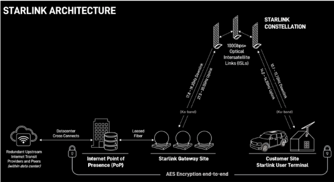
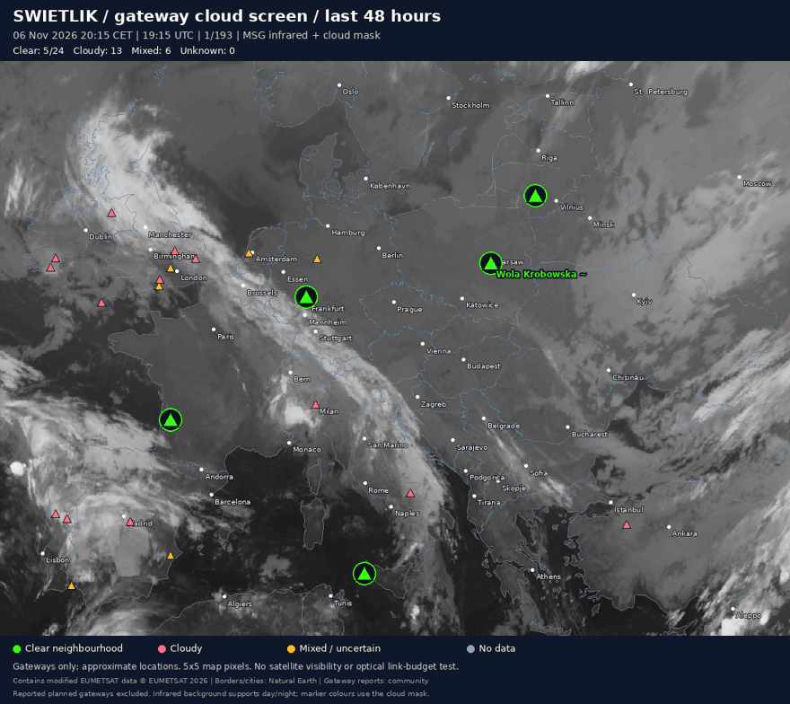
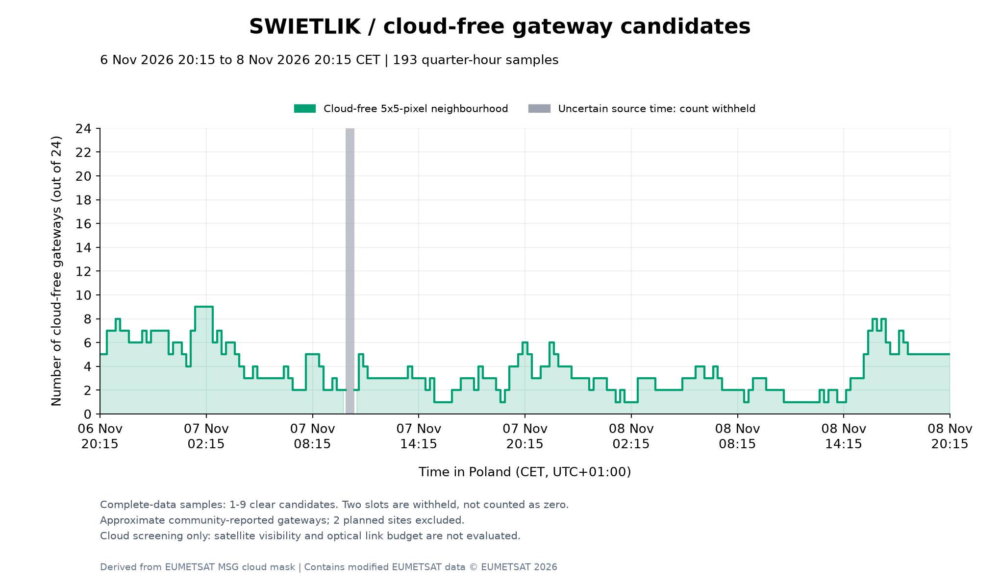
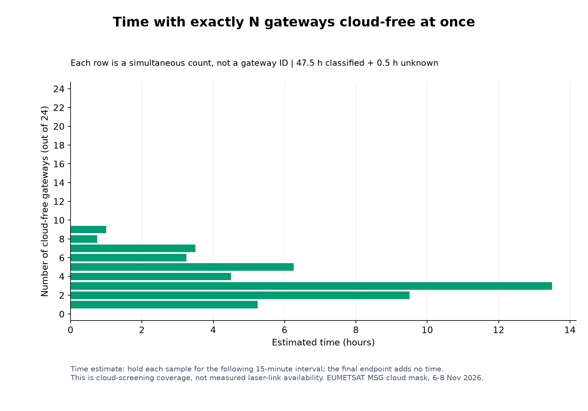
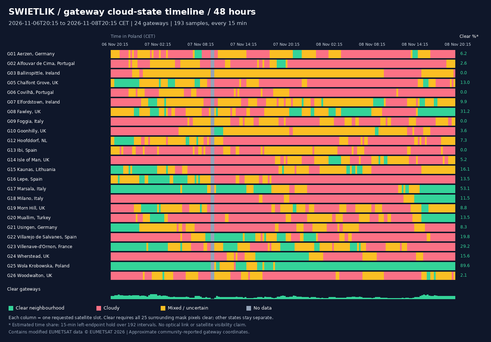
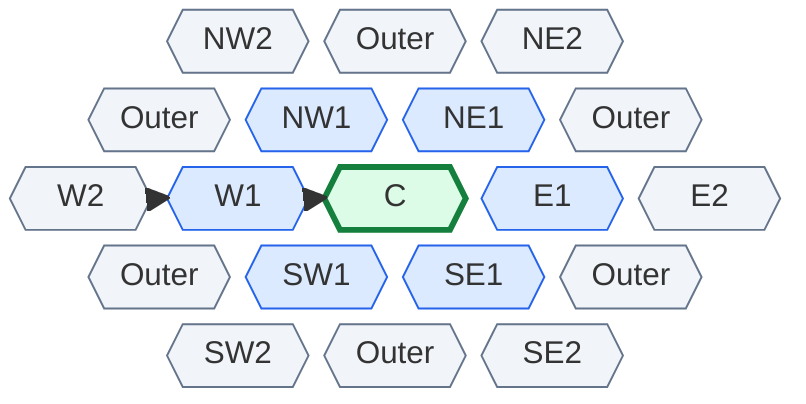

# Świetlik - Earth-to-Orbit Laser Communications

With Świetlik, I propose using weather data and radio measurements to help route traffic through optical ground stations. This is still an untested idea. I have not built or validated the optical network, radio warning method or predictive routing controller.

I would like to explore communication with satellites in low Earth orbit (LEO), up to about 1,000 km above Earth. My aim would be to make fast laser uplinks useful despite cloud interruptions: predict worsening conditions, raise the cost of an affected laser path early, and move traffic to another gateway or a backup radio link.

For an initial design study, I would consider a target of **approximately 100 Gbps per optical link in suitable conditions**. This is an assumption to investigate. I would still need to check terminal compatibility, transmitter power, path losses, receiver sensitivity and tracking performance.

## Why investigate the gateway link?

Satellite networks use several types of links: user terminal ↔ satellite, satellite ↔ satellite, and satellite ↔ ground gateway. Traffic then travels through terrestrial fibre to an internet Point of Presence (PoP). **I focus on gateway locations in this study. PoPs are internet interconnection sites.**

*Architecture illustration credited to SpaceX/Starlink, included here as a reference. The labels show the system in this image and may differ between satellite generations.*

Starlink already uses optical inter-satellite links; its [technology overview](https://starlink.com/technology) describes rates of up to 200 Gbps. I want to focus on the ground ↔ satellite segment. I am not proposing changes to customer terminals or their radio links at this stage.

**My working hypothesis:** as the satellite network and its optical links grow, radio feeder links at gateways could limit total capacity. To check whether they are already a bottleneck, I would need measurements of traffic, radio capacity, scheduling and ground backhaul. Comparing carrier frequencies alone is not enough.

My first estimate was that a radio link might deliver around **0.6-1.2 Gbps**, based on experience with terrestrial microwave equipment. That number is **not a verified Starlink feeder-link specification or a physical limit of radio**. Throughput depends on channel bandwidth, signal-to-noise ratio, modulation, coding, polarisation, spatial reuse and the number of simultaneous links.

Based on [this Canadian ISED notice](https://ised-isde.canada.ca/site/spectrum-management-telecommunications/en/learn-more/key-documents/consultations/notice-request-received-spacex-canada-corp-use-e-band-frequencies-canada), the gateway radio bands are around 17.8-19.3 GHz from satellite to ground and 27.5-30 GHz in the return direction, from ground to satellite. It also documents a request for E-band feeder links at 71-76 GHz downlink and 81-86 GHz uplink. I also note that [this Starlink case study](https://starlink.com/pl/business/case-studies/cnt-ep) reports up to 10 Gbps symmetric throughput for a Bonded Gateway solution.

## Why laser communication is worth pursuing

NASA's **TeraByte InfraRed Delivery (TBIRD)** is a relevant LEO demonstration. I included a local copy of the [NASA TechPort report - project 95868](<source/laser/TechPort Report Download 11_08_2026 8_08 PM CET.pdf>), which describes a design for burst rates up to **200 Gbps from a satellite to Earth**. The report describes earlier plans; [NASA's account of the April 2023 demonstration](https://www.nasa.gov/centers-and-facilities/goddard/nasa-partners-achieve-fastest-space-to-ground-laser-comms-link/) confirms that the 200 Gbps downlink was achieved.

**TBIRD and [Deep Space Optical Communications (DSOC)](https://www.nasa.gov/mission/deep-space-optical-communications-dsoc/) are separate projects.** DSOC provides another optical-communications reference, including flight and ground terminals, for operation beyond the Earth-Moon system. The 200 Gbps LEO result I refer to here belongs to TBIRD.

These demonstrations are why I think high-capacity optical feeder links are worth studying. A demonstrated downlink does not establish a 100-200 Gbps uplink to an existing Starlink satellite: I would still need a compatible receiver in space, a ground transmitter, accurate tracking and a tested link budget.

In a future design, I would need to address two main difficulties:

- **Atmospheric transmission:** clouds can block the beam; fog, thin cloud, aerosols and turbulence can also affect it. Weather availability varies by site and time.
- **Acquisition, pointing and tracking:** a narrow beam must acquire and follow a rapidly moving LEO satellite accurately throughout a contact.

Optical communication offers several possible benefits:

- **More data during each contact:** a high-capacity optical link can move a larger volume through a short LEO visibility window. TBIRD provides a demonstrated example of this principle.
- **Less pressure on radio spectrum:** an optical feeder path can carry additional traffic without consuming the Ka-band channels used by radio feeder links.
- **Narrow beams:** the beam focuses energy towards the receiver and reduces interference between separate links. It also makes interception more difficult. Encryption is still needed.
- **Smaller space terminals:** an optical terminal can be smaller, lighter and use less power than radio equipment with similar performance. The result depends on the design.
- **Extra capacity with a backup:** an optical link can carry large amounts of data in good weather. Radio or another gateway can carry traffic during interruptions. A fast link can still be useful even if it is not always available.

NASA discusses these benefits in its [optical communications overview](https://www.nasa.gov/technology/space-comms/optical-communications-overview/). I would like to study how much of this capacity a ground network could use under changing weather conditions.

## The practical idea: fast links with a stable backup

The idea comes from my experience with a **roughly 1.2 km terrestrial link in the 60 GHz band**, which I operated about ten years ago. In good conditions, I could get about **1 Gbps**, but even moderate rain affected the signal. I also had a slower **5 GHz link, up to about 300 Mbps**, as a stable backup.

I wrote a script to monitor the 60 GHz signal. When the signal followed a known pattern of falling quality, the script raised the link's cost and traffic moved to the 5 GHz backup. After a year, I estimated that the faster link had been available for more than **90% of the time**, which I considered a useful result.

The main idea is simple: a fast link can carry a lot of traffic, even with occasional outages, if a stable backup is available. I propose investigating the same routing principle for optical gateways. A future system could:

1. Monitor satellite cloud products and local weather, alongside optical-link measurements when available.
2. Investigate whether degradation of nearby or gateway radio signals provides useful advance warning. A proposed local monitoring cluster contains six antennas in a straight line; suitable frequencies, sources and spacing remain to be established.
3. Raise the cost of an optical path before a predicted weather outage, while the link is still working.
4. Move traffic to a clearer gateway or a backup radio link, after checking satellite visibility and spare capacity.
5. Give the laser link priority again only after conditions stay stable. Use smoothing, separate failure and recovery thresholds (hysteresis), and a minimum waiting time to prevent repeated route changes (flapping).

**I would still need to test the radio warning method.** Weather affects radio and optical links in different ways. A falling radio signal does not always mean that a laser link will fail. Radio measurements also may not describe the clouds along the beam between a gateway and a satellite.

## Early weather illustration: 48 hours over European gateways

To explore the idea, I started with a question: **how many candidate gateway locations have cloud-free surroundings at the same time?** For this first analysis, I used a Europe-spanning set, approximately from Portugal to Ukraine, using EUMETSAT satellite products accessed directly through EUMETView. Zoom Earth inspired the visual approach; its screenshots were not the analysis input.

| Study setting | Value |
|---|---|
| Period in Poland | **6 November 2026, 20:15 → 8 November 2026, 20:15 CET** |
| Period in UTC | 6 November 19:15 → 8 November 19:15 UTC |
| Coverage | 48 hours; 193 requested slots, 15 minutes apart |
| Candidate locations | 24 community-reported gateways with source status `operational` |
| Exclusions | 2 reported planned gateways; all PoPs |
| Classification input | EUMETSAT MSG categorical cloud mask, `msg_fes:clm` |
| Animation background | MSG 10.8 µm infrared, `msg_fes:ir108`, for day and night |
| Stored classifications | 4,632 gateway/time records |

The site list is incomplete, and the coordinates are approximate. I have not confirmed the current operating status of each site. Wola Krobowska uses village-centre coordinates. See the [gateway map](maps/europe.svg), [GeoJSON](data/gateways.geojson) and [study methodology](maps/weather-48h-2026-11-08/README.md) for provenance and limitations.

November provides an autumn test case. **These two days have not been established as a worst-case weather period.** To estimate seasonal or annual availability, I would need a much longer record. I would also need to include night conditions, fog, cloud layers and the satellite position.

### Animation

[Full animation at 15-minute sampling (MP4)](maps/weather-48h-2026-11-08/animation.mp4). Triangles represent gateways. Green means a clear neighbourhood, red cloudy, amber mixed, and grey unknown. The background is infrared imagery; marker colours come from the separate cloud mask.

### How many gateways were cloud-free, and when?

**X: time in Poland, oldest on the left. Y: number of cloud-free gateway candidates, out of 24.** Grey bands show samples with uncertain source times. They do not mean that no gateways were clear.

In the **191 usable time samples**, between **1 and 9** gateways had a clear neighbourhood, with an average of **3.65** per sample. Every usable sample had at least one such location. Two requested times returned the same cloud-mask image. I treated both samples as unknown because I could not confirm two separate acquisition times. This does not prove a network outage.

The second chart uses **X: estimated hours; Y: number of cloud-free gateways**. To estimate hours, I used a method that applies each sample to the next 15-minute interval. The last sample adds no extra time. Classified intervals total **47.5 hours**, with **0.5 hours unknown**. This estimate cannot show changes between satellite scans.

### Gateway cloud-state timeline

Each row shows **one named gateway**, and the horizontal axis shows time during the 48-hour study. Green means clear, red means cloudy, amber means mixed conditions and grey means unknown. All 24 sites are included.

The [total cloud-free hours per gateway](maps/weather-48h-2026-11-08/gateway-clear-hours.png) chart shows the sum for each site, sorted from highest to lowest. It includes sites with zero clear hours.

For **Wola Krobowska**, the same method gives:

| Neighbourhood state | Samples | Estimated time |
|---|---:|---:|
| Clear | 173 | 43.00 h |
| Cloudy | 1 | 0.25 h |
| Mixed | 17 | 4.25 h |
| Unknown | 2 | 0.50 h |

These are **cloud-screening results**. A station counts as clear only when all pixels in a 5 × 5 neighbourhood of the rendered mask are clear. The CSV also retains the centre-pixel class and the cloud fraction among known pixels. Mixed and unknown states are kept separate. This local rule checks clouds around a site. It does not calculate a link budget or measure laser uptime.

Clear sky around a station does not guarantee a clear beam path to a satellite. The study also does not test whether those clear gateways can reach the same satellite, replace one another's traffic, or provide any particular aggregate throughput. I cannot yet use the gateway count and the 100 Gbps target to calculate network capacity.

### Data and detailed results

- [Per-gateway, per-time classifications (CSV)](maps/weather-48h-2026-11-08/gateway-cloud-timeseries.csv): UTC/Poland time, location, clear/cloudy/mixed/unknown state, centre class and quality notes.
- [Gateway summaries (CSV)](maps/weather-48h-2026-11-08/gateway-summary.csv) and [full results table](maps/weather-48h-2026-11-08/RESULTS.md).
- [Consecutive sample runs (CSV)](maps/weather-48h-2026-11-08/gateway-state-runs.csv) and [per-gateway timeline](maps/weather-48h-2026-11-08/gateway-timeline.png).
- [Network counts over time (CSV)](maps/weather-48h-2026-11-08/network-timeseries.csv) and [count-duration distribution (CSV)](maps/weather-48h-2026-11-08/network-clear-count-distribution.csv).
- [Download manifest](maps/weather-48h-2026-11-08/manifest.json): source URLs, requested times, hashes and quality flags.

## What comes next

Below, I describe the work I would like to explore next. These are proposals for a future system. I would need to design, simulate and test each part before treating it as a working solution.

### Proposed goal: move traffic before the laser link fails

**I would want a future controller to raise the laser link's cost before a predicted weather outage, while the link is still carrying traffic.** My aim would be to leave enough time to prepare a backup and move traffic before the connection fails. I would need to test whether the proposed measurements can give that warning.

I propose combining two inputs:

- **Satellite weather data:** cloud position and movement from products like those shown in Zoom Earth. A future controller could use timestamped data from the source service, such as EUMETSAT, rather than depend on screenshots.
- **Radio-link measurements from gateways:** received signal level, signal-to-noise ratio (SNR) and the speed of signal changes, where these measurements are available. The proposed controller would need timestamped measurements from the sites to compare events at different locations. Access to these radio measurements has not been established.

### A honeycomb monitoring cluster

I propose a **two-dimensional honeycomb of neighbouring hexagonal cells**. In this concept, an inner ring and an outer ring would surround the central gateway. Comparing a nearer and a farther gateway in each of six main directions might help detect weather moving towards the centre.

**C** is the central gateway. **1** marks an inner gateway and **2** a farther gateway in the same direction. N, S, E and W indicate directions. The arrows show the example warning sequence **W2 → W1 → C**. Cells labelled **Outer** fill the second ring between the main directions.

[SVG version of the diagram](docs/images/honeycomb-monitoring.svg).

The drawing uses **19 cells: one central cell, six inner cells and twelve outer cells**. I use this as an example layout. I am not proposing a fixed requirement to build exactly 19 stations. The extra outer cells fill the spaces between the six main directions. Cell size, site spacing and the real radio measurement paths still need to be designed. Existing gateways will not form a perfect honeycomb, so a future controller would need their actual positions.

In the example, weather moves from the west towards the centre: **W2 signal falls first, then W1 signal falls**. A matching cloud movement in the satellite data would support the warning. If tests support this warning pattern, a future controller could raise the central laser link's cost before the weather affects its beam path. I investigate the same outer-to-inner pattern in the other directions.

I am proposing this prediction method for future testing. I have not tested it in the 48-hour study. That study contains cloud-mask data only, with no radio measurements. The six-antenna idea is an initial hardware concept. The number of measurement channels and their mapping to the surrounding sites still need testing.

### Proposed control sequence

These are the steps I would consider when designing and testing a controller. The current cloud-analysis scripts do not perform them.

1. **Learn the normal signal at each site.** Compare signal changes with a local reference level. Filter short spikes. Where the radio link follows a satellite, account for changes caused by elevation, handovers and transmitter settings.
2. **Look for movement towards the central station.** Detect a lasting signal drop at an outer gateway, followed by a similar drop at the inner gateway on the same side. Compare their timestamps with the cloud movement. A drop at one distant site alone is not enough to confirm an approaching outage.
3. **Estimate the warning time.** Use site positions, event timing and cloud data to estimate when conditions may affect the central beam. The estimate must include data age, processing delay, switching time and uncertainty. Test these values with real measurements before choosing thresholds.
4. **Prepare another path and raise the laser cost early.** Check that another gateway or radio link can reach the required satellite or network destination and has enough spare capacity. Move traffic while the optical path still works. A higher cost makes the path less attractive; it does not guarantee that routing stops using it. If needed, withdraw the path from normal routing before the predicted outage. Keep monitoring it for recovery. This concerns traffic selection, not automatically switching off laser power.
5. **Handle missing warnings and sudden failures.** Missing or stale measurements must not count as good weather. Use a conservative backup policy. Direct optical alarms and normal failure detection must still protect the link if the predicted outer-to-inner pattern does not appear.
6. **Recover slowly.** Return traffic only after weather and link measurements stay good for a defined period. Use a different recovery threshold and a minimum waiting time to avoid flapping.

Radio links and laser beams may cross different parts of the atmosphere. A moving radio fade is useful only if tests show that it predicts the optical problem with enough warning time. I would need to measure missed outages, false warnings, switching losses and how much optical capacity remains usable after early switching.

Next, I would like to combine cloud data with satellite positions, elevation limits and cloud height to estimate conditions along the beam path. I would also need to check terminal compatibility and tracking performance, and calculate a link budget for the assumed 100 Gbps target. If I can obtain suitable radio and optical measurements, I could use them to test the prediction idea and simulate gateway handovers. I would need a longer weather record before estimating seasonal availability.

## Reproduce the exploratory weather analysis

Full details: [48-hour study README](maps/weather-48h-2026-11-08/README.md).

## Sources and attribution

- **Starlink / SpaceX:** supplied architecture illustration; [technology overview](https://starlink.com/technology); [local latency document](source/StarlinkLatency.pdf), also [published by Starlink](https://starlink.com/public-files/StarlinkLatency.pdf).
- **NASA:** [local TBIRD TechPort report](<source/laser/TechPort Report Download 11_08_2026 8_08 PM CET.pdf>), [TechPort 95868](https://techport.nasa.gov/projects/95868), [200 Gbps demonstration report](https://www.nasa.gov/centers-and-facilities/goddard/nasa-partners-achieve-fastest-space-to-ground-laser-comms-link/), and [DSOC](https://www.nasa.gov/mission/deep-space-optical-communications-dsoc/).
- **ISED:** [SpaceX Ka-band and E-band gateway notice](https://ised-isde.canada.ca/site/spectrum-management-telecommunications/en/learn-more/key-documents/consultations/notice-request-received-spacex-canada-corp-use-e-band-frequencies-canada). This is a Canadian example, not a verification of every European gateway's radio configuration.
- **EUMETSAT:** [EUMETView](https://user.eumetsat.int/data-access/eumetview/resources). Contains modified EUMETSAT data © EUMETSAT 2026. Source capabilities and request metadata are retained with the study.
- **Gateway inventory:** [juliensimon/starlink-viz](https://github.com/juliensimon/starlink-viz/blob/master/data/ground-stations.json), snapshot timestamp 2026-06-10; reports may be outdated. Individual references and notes are recorded in the GeoJSON. Check upstream licensing before redistribution beyond this attributed reference dataset.
- **Wola Krobowska:** [GeoNames](https://www.geonames.org/767533/krobowska-wola.html), village-centre approximation, CC BY 4.0. The community dataset's inconsistent coordinates were replaced; the precise antenna site remains unverified.
- **Country outlines and cities:** [Natural Earth](https://www.naturalearthdata.com/about/terms-of-use/), public domain; source snapshots from [natural-earth-vector](https://github.com/nvkelso/natural-earth-vector). Boundary depiction follows that dataset.

I have kept the [earlier three-hour pilot](maps/weather-2026-11-05/README.md) as exploratory history. It included PoPs before I changed the study scope to gateways only. Its neighbourhood resolution differs, so results are not directly interchangeable. Historical PeeringDB/PoP files are not inputs to the current gateway study.
