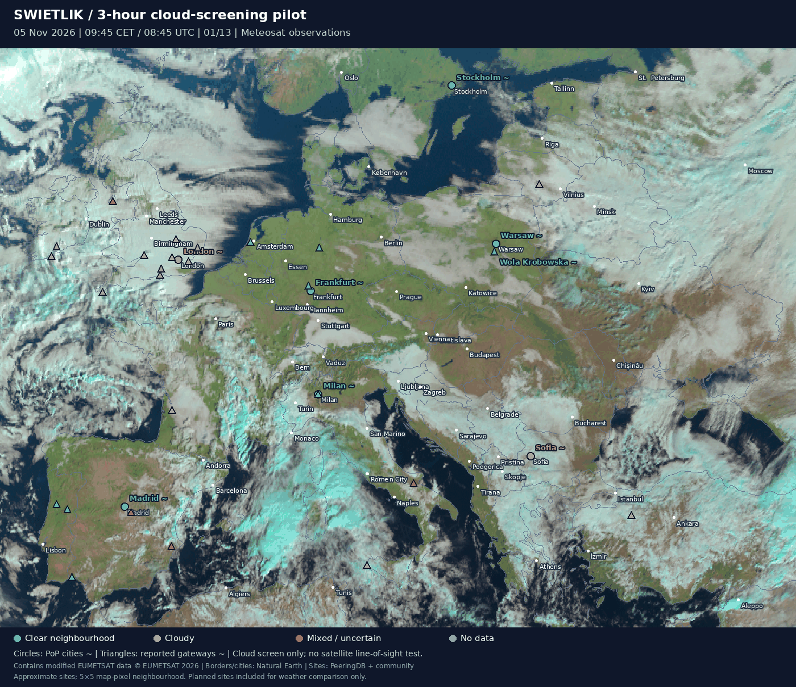

# Three-hour cloud-screening pilot — 5 November 2026



[Static preview](preview.png) · [Per-site time series](site-cloud-screen.csv) · [Per-site summary](summary.csv) · [Download manifest](manifest.json)

## What was tested

13 requested quarter-hour satellite slots, 08:45–11:45 UTC (09:45–12:45 CET), spanning three hours. The user's Zoom Earth reference was 12:50 CET; the pilot ends five minutes earlier to match the MSG 15-minute grid. These are observations requested from EUMETSAT, not an ICON precipitation forecast and not screenshots downloaded from Zoom Earth. Zoom Earth returned HTTP 403 to the direct access attempt.

Background: EUMETView `msg_fes:rgb_natural` (Natural Colour RGB, MSG, 0°). Classification: `msg_fes:clm` (Cloud Mask, MSG, 0°). Both layers are requested with the same time and CRS:84 bounding box, longitude/latitude `[-12, 35, 41, 61]`, 1400 × 1020 pixels. Points, outlines and imagery share the same geographic transformation. This map is equirectangular, unlike the separate Mercator SVG.

The service advertises `nearestValue=1`: requested quarter-hour timestamps are recorded, but exact underlying scan acquisition times are not independently verified. Distinct image hashes are required for all 13 slots in each layer; empty frames and repeated image sequences fail the script. Missing requests fail instead of being silently replaced with current images.

## Point colours

Cloud screening uses the rendered categorical mask, not the brightness of the RGB background. The retrieved palette uses green `(0,192,0)` for clear land, blue `(0,0,255)` for clear water, and white `(255,255,255)` for cloud. Other colours are treated as unknown. A WMS GetFeatureInfo check confirmed the RGB band values at a sampled clear-land pixel. This remains a rendered-mask prototype; scientific follow-up should use the original categorical cloud product and quality flags.

For a 5 × 5 map-pixel neighbourhood around each approximate site:

- Green: all neighbourhood pixels classified clear.
- Red: all neighbourhood pixels classified cloudy.
- Amber: a mixture of clear and cloudy pixels.
- Grey: at least one unknown or out-of-map pixel.

The CSV also records the centre pixel and the cloud fraction among known neighbourhood pixels. This is a fraction of rendered map pixels, not a probability or measured optical attenuation. The neighbourhood covers several kilometres and its ground size varies with latitude. No-data and mixed cases must not be counted as clear.

Circles are approximate PoP cities, triangles are community-reported gateways. Both are displayed at the user's request, but only gateway locations are relevant candidates for ground-to-space terminals. Sites reported as planned remain visible for weather comparison, not operational capacity. Wola Krobowska is a village-centre approximation. The lists are incomplete and source operational claims remain unverified.

**Clear above a station does not establish an available laser link.** This pilot excludes the slant path to a satellite, cloud height, optical depth, thin cirrus, fog, aerosols, turbulence, pointing, link budget and satellite visibility. It demonstrates retrieval, map alignment and time-dependent cloud screening only. It also does not yet test the proposed radio-signal predictor.

## Reproduce

Install Pillow (`python3 -m pip install Pillow`), then run:

```bash
python3 scripts/weather_pilot.py
# Re-render cached frames without network:
python3 scripts/weather_pilot.py --offline
```

Run from the repository or supply the absolute script path. The script resolves paths from its own location. Original downloaded WMS frames are retained under `raw/`; `manifest.json` records URLs and SHA-256 hashes. `frame-00.png` through `frame-12.png` are annotated frames. `animation.gif` loops through the sequence every 8.45 seconds.

## Sources

- [EUMETSAT data access](https://user.eumetsat.int/data-access): historical and near-real-time data access options.
- [EUMETView documentation](https://user.eumetsat.int/data-access/eumetview/resources).
- [WMS capabilities](https://view.eumetsat.int/geoserver/wms?service=WMS&request=GetCapabilities&version=1.3.0): layer descriptions, time grids and scene classification. A retrieved capabilities snapshot and style snapshot are saved alongside the results.
- [Zoom Earth](https://zoom.earth/): identifies EUMETSAT Meteosat as an imagery source; ICON/GFS are separate forecast sources.
- Natural Earth (public-domain boundaries/cities), PeeringDB and community site attribution: see the repository README and GeoJSON feature properties.

Contains modified EUMETSAT data © EUMETSAT 2026. Source frames and the cloud mask remain separate from our derived point classifications.
