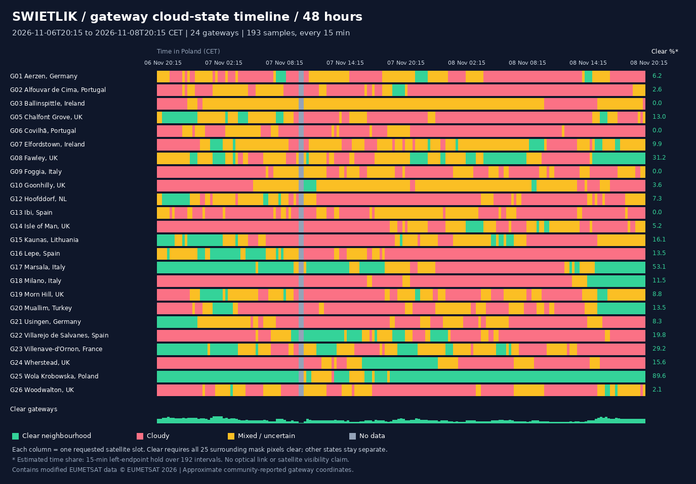

# Gateway-only 48-hour cloud screening — 6–8 November 2026

[Gateway count vs time](gateway-count-by-time.png) · [Count-duration chart](gateway-count-duration.png) · [Cloud-free hours per gateway](gateway-clear-hours.png) · [Results and timeline](RESULTS.md) · [Full 15-minute animation (MP4)](animation.mp4) · [Hourly GIF preview](animation-hourly.gif)



## Data files

| File | Contents |
|---|---|
| [gateway-cloud-timeseries.csv](gateway-cloud-timeseries.csv) | One gateway per requested time: UTC and Poland time, gateway ID/name, approximate coordinates, centre-pixel class, neighbourhood cloud fraction, known-pixel count and derived cloud state. |
| [gateway-state-runs.csv](gateway-state-runs.csv) | Consecutive equal-state sample runs per gateway, with first/last observed time. These are observed sample spans, not guaranteed continuous conditions. |
| [gateway-summary.csv](gateway-summary.csv) | Counts for all four states and estimated hours per gateway. |
| [network-timeseries.csv](network-timeseries.csv) | Number of clear, cloudy, mixed and unknown gateways at each time. |
| [network-clear-count-distribution.csv](network-clear-count-distribution.csv) | Simultaneous clear-gateway counts, sample counts and estimated duration. |
| [results.json](results.json) | Exact time window, totals and missing-frame counts. |
| [manifest.json](manifest.json) | Requested timestamps, source URLs, SHA-256 hashes, palette counts and retrieval errors. |
| [capabilities.xml](capabilities.xml) | Retrieved layer descriptions, available time ranges and WMS capabilities. |

These files contain **gateways only**, not Points of Presence. The input has 26 reported gateways; the two reported planned sites are excluded. The remaining 24 have a community source status of `operational`, which has not been independently verified. Approximate site positions also remain unverified. Wola Krobowska uses a village-centre approximation.

## Exact period and sampling

Requested slots: **6 November 2026 20:15 CET to 8 November 2026 20:15 CET**, or **6 November 19:15 UTC to 8 November 19:15 UTC**. This spans exactly 48 hours with 193 endpoints at 15-minute spacing. The end was selected as the latest common slot advertised for both layers, no later than the task's recorded as-of time (8 November 19:38:07 UTC).

The manifest freezes this period, so rerunning does not silently shift the analysis. The full MP4 includes all 193 frames at 6 fps; the lightweight GIF shows every fourth frame (hourly), including both endpoints.

## What is being measured?

We download **EUMETSAT MSG Cloud Mask (`msg_fes:clm`)**, a satellite-derived categorical classification, and read the rendered class at and around each gateway coordinate. This is not manual visual judgement of the infrared picture and not a Zoom Earth point forecast.

The infrared background (`msg_fes:ir108`, SEVIRI 10.8 µm) is for day/night visualization only. It is not used to infer clear sky by brightness. Both layers use WMS 1.3.0, CRS:84, the same longitude/latitude extent `[-12, 35, 41, 61]`, 1100 × 800 pixels and the same requested timestamp. Coastlines, city labels and points use that same transformation. This resolution differs from the earlier three-hour pilot, so 5 × 5 neighbourhoods are not identical ground footprints between studies.

The categorical mask's observed rendering palette is clear land `(0,192,0)`, clear water `(0,0,255)`, and cloud `(255,255,255)`. Unrecognised colours count as unknown. Per-frame palette counts are retained in the manifest. The previous pilot additionally checked RGB class values using WMS GetFeatureInfo. Scientific follow-up should retrieve the original categorical product and its quality flags rather than rely on a rendered WMS palette.

For a **5 × 5 map-pixel neighbourhood**:

- `clear` / green: all 25 pixels classified clear.
- `cloudy` / red: all 25 pixels classified cloudy.
- `mixed` / amber: all pixels known, with both clear and cloudy present.
- `unknown` / grey: missing mask, out-of-map neighbourhood or at least one unrecognised pixel.

`centre_class` reports the centre pixel separately. `cloud_fraction_known_pixels` is the number of cloudy pixels divided by the number of known pixels, not a cloud probability, optical attenuation or percent of time. It is empty when no pixels are known. `mixed` and `unknown` are never counted as clear. The map-pixel footprint is several kilometres and varies with latitude.

Identical mask images returned for multiple requested timestamps are conservatively withheld: every member of such a group gets `ambiguous_time` in the manifest and `unknown` in the cloud-state CSV. This is a quality precaution, not proof that the source is wrong; unchanged masks and nearest-time fallback cannot be distinguished without source acquisition metadata. `mask_data_status` and `mask_quality_note` explain this directly in each CSV row.

A missing infrared background does not erase a valid cloud-mask classification; a missing mask makes every gateway unknown at that slot. Failed downloads are logged, not replaced with current images. All requested slots and errors remain in the outputs. The service advertises `nearestValue=1`, so these are **requested quarter-hour slots**; exact underlying scan acquisition times have not been independently verified. Repeated hash counts and withheld slots are recorded for review, not treated as proof of independent observations.

## Time estimates

There are 192 fifteen-minute intervals between 193 endpoints. Summary hours use the state at each interval's left endpoint for that interval; the final endpoint contributes zero additional time. This illustrative sample-hold estimate sums to 48 hours per gateway. It does not detect transitions between scans. The CSV separately preserves all 193 sample counts and the percentage of clear samples.

`gateway-state-runs.csv` instead reports the first and last observations in each consecutive run. A single-sample run has zero observed span; it is not evidence of a zero-length physical weather event.

## Limits

This is overhead cloud screening, **not demonstrated optical-link availability**. It excludes satellite visibility, slant paths through clouds away from the ground point, cloud height and optical depth, thin cirrus, fog, aerosols, turbulence, pointing and link budget. Approximate or inaccurate gateway coordinates can change the classification. Source claims of gateway activity and site completeness remain unverified. Two days cannot establish seasonal availability. The proposed radio-monitoring predictor is not tested here.

## Reproduce

Install Pillow, and ensure ffmpeg is available for MP4 export:

```bash
python3 -m pip install Pillow
python3 scripts/weather_48h.py
python3 scripts/weather_heatmap.py
# Optional count plots (requires matplotlib):
python3 scripts/plot_gateway_counts.py
```

`--download-only` fetches and analyses without rendering. `--offline` requires locally cached source frames; missing cache files are recorded as missing. Original WMS images are saved under `raw/`, and annotated frames under `frames/`; these regenerable directories are ignored by Git. CSVs, manifests, final animations, previews and the results report remain available for the repository.

## Sources and attribution

- [EUMETView](https://user.eumetsat.int/data-access/eumetview/resources): WMS imagery and cloud mask. [Capabilities](https://view.eumetsat.int/geoserver/wms?service=WMS&version=1.3.0&request=GetCapabilities).
- [EUMETSAT data access](https://user.eumetsat.int/data-access): historical and near-real-time services.
- Natural Earth: public-domain country outlines and populated places.
- Gateway reports: [juliensimon/starlink-viz](https://github.com/juliensimon/starlink-viz/blob/master/data/ground-stations.json), snapshot timestamp 2026-06-10; individual source links and notes are retained in the repository GeoJSON.
- [GeoNames: Krobowska Wola](https://www.geonames.org/767533/krobowska-wola.html): village-centre approximation, CC BY 4.0.

Contains modified EUMETSAT data © EUMETSAT 2026. See the root README for gateway provenance and upstream licensing notes. No screenshots were downloaded from Zoom Earth for this test.
