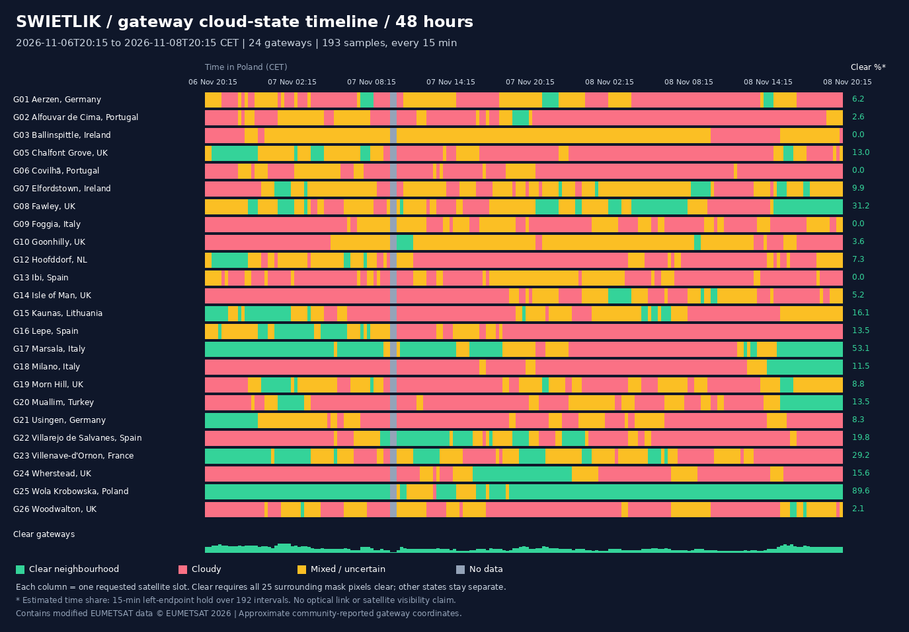

# Gateway cloud-screening results — 6–8 November 2026

Window: **2026-11-06T20:15:00+01:00 → 2026-11-08T20:15:00+01:00** (Poland), exactly 48 hours.

24 reported-operational gateways × 193 requested quarter-hour slots = 4632 records. No PoPs or reported planned gateways.

Clear neighbourhoods per sample: **0–9**. Samples with none clear: **2/193**. Missing cloud masks: 0; missing infrared frames: 0; ambiguous mask slots withheld: 2.

Fully unknown samples: **2**. Among complete-data samples, clear gateways range from **1 to 9**; samples with no clear gateway and complete data: **0**.

| Gateway | Clear samples | Cloudy samples | Mixed samples | Unknown samples | Estimated clear hours* |
|---|---:|---:|---:|---:|---:|
| Wola Krobowska, Poland | 173 | 1 | 17 | 2 | 43.00 |
| Marsala, Italy | 103 | 54 | 34 | 2 | 25.50 |
| Fawley, UK | 61 | 46 | 84 | 2 | 15.00 |
| Villenave-d'Ornon, France | 56 | 60 | 75 | 2 | 14.00 |
| Villarejo de Salvanes, Spain | 38 | 120 | 33 | 2 | 9.50 |
| Kaunas, Lithuania | 31 | 88 | 72 | 2 | 7.75 |
| Wherstead, UK | 30 | 130 | 31 | 2 | 7.50 |
| Lepe, Spain | 26 | 121 | 44 | 2 | 6.50 |
| Muallim, Turkey | 27 | 118 | 46 | 2 | 6.50 |
| Chalfont Grove, UK | 25 | 114 | 52 | 2 | 6.25 |
| Milano, Italy | 23 | 157 | 11 | 2 | 5.50 |
| Elfordstown, Ireland | 19 | 50 | 122 | 2 | 4.75 |
| Morn Hill, UK | 17 | 93 | 81 | 2 | 4.25 |
| Usingen, Germany | 16 | 117 | 58 | 2 | 4.00 |
| Hoofddorf, NL | 14 | 117 | 60 | 2 | 3.50 |
| Aerzen, Germany | 12 | 109 | 70 | 2 | 3.00 |
| Isle of Man, UK | 10 | 131 | 50 | 2 | 2.50 |
| Goonhilly, UK | 7 | 62 | 122 | 2 | 1.75 |
| Alfouvar de Cima, Portugal | 5 | 142 | 44 | 2 | 1.25 |
| Woodwalton, UK | 4 | 119 | 68 | 2 | 1.00 |
| Ballinspittle, Ireland | 0 | 36 | 155 | 2 | 0.00 |
| Covilhã, Portugal | 0 | 153 | 38 | 2 | 0.00 |
| Foggia, Italy | 0 | 120 | 71 | 2 | 0.00 |
| Ibi, Spain | 0 | 122 | 69 | 2 | 0.00 |

*Hours use each sample as an estimate for the following 15-minute interval. The final endpoint is not given a further 15 minutes, so each site totals exactly 48 hours across all four states. Changes between scans are not observed. Clear sky above an approximate site is not proven laser-link availability.

Definitions, source details and limitations: [README](README.md).
